# 验收测试报告

| 项 | 内容 |
| --- | --- |
| 项目 | 知味厨房 · 智能电子菜谱（Web / PWA） |
| 测试方式 | 纯 GUI 黑盒测试（浏览器自动化：真实点击 / 键盘输入 / 截图 + 只读 DOM 双重验证） |
| 测试环境 | Windows 10 · ZCode 内置浏览器（Chromium 内核，1280×720 / 375×700）· 本地 `http://127.0.0.1:8080`（python http.server） |
| 测试日期 | 2026-10-27 |
| 结论 | **通过**（发现 2 个功能问题 + 1 个发布策略问题，均已修复并回归验证） |

## 一、测试点明细

| # | 测试点 | 结果 | 证据 |
| --- | --- | --- | --- |
| T1 | 首页渲染：6 张菜谱卡、AI/实拍徽标、视频角标、配额 chips、筛选组 | ✅ |  |
| T2 | 搜索"番茄"→精确 1 张；来源+搜索组合筛选→正确空态；键盘清空→恢复 6 张 | ✅ | 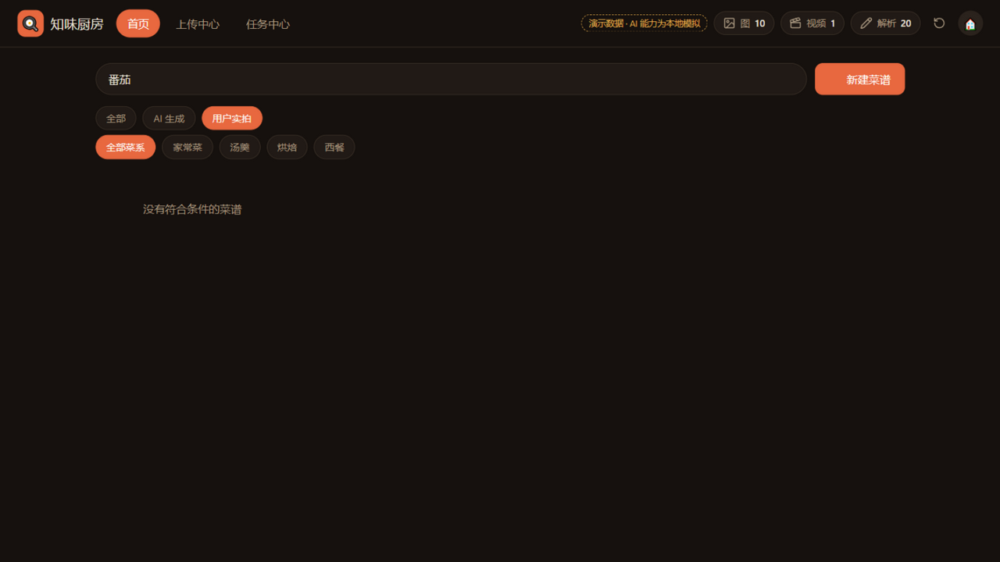 |
| T3 | 详情页：步骤/火候/贴士、AI 徽标、Tab 切换、视频空态 CTA、收藏 toggle + toast | ✅ | 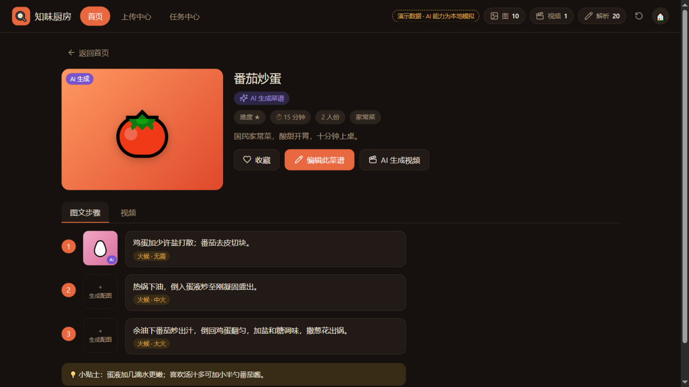 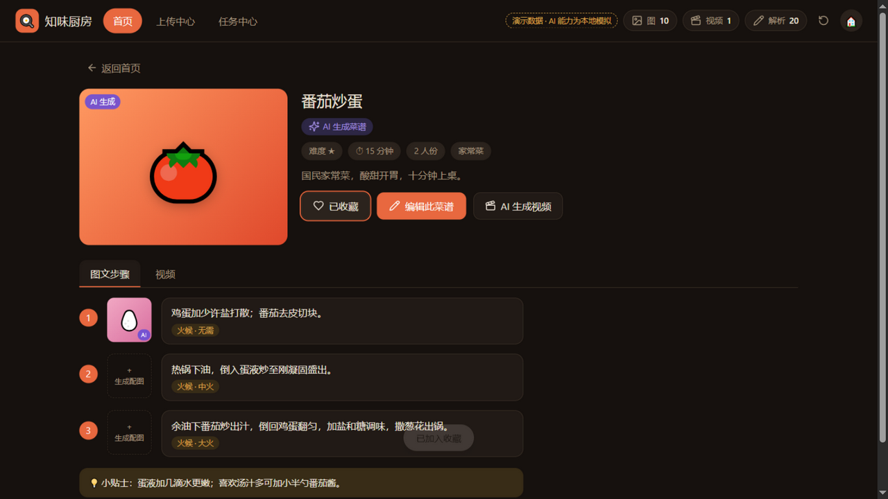 |
| T4 | 智能解析：弹窗→解析→表单回填、配额 20→19、toast（修复后：4 食材 + 3 条干净步骤） | ✅（修复后） | 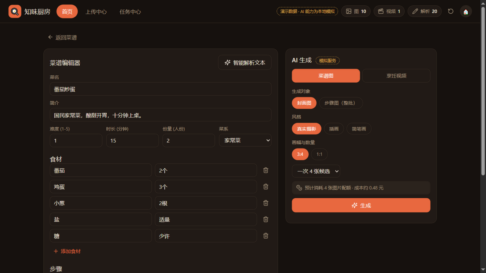 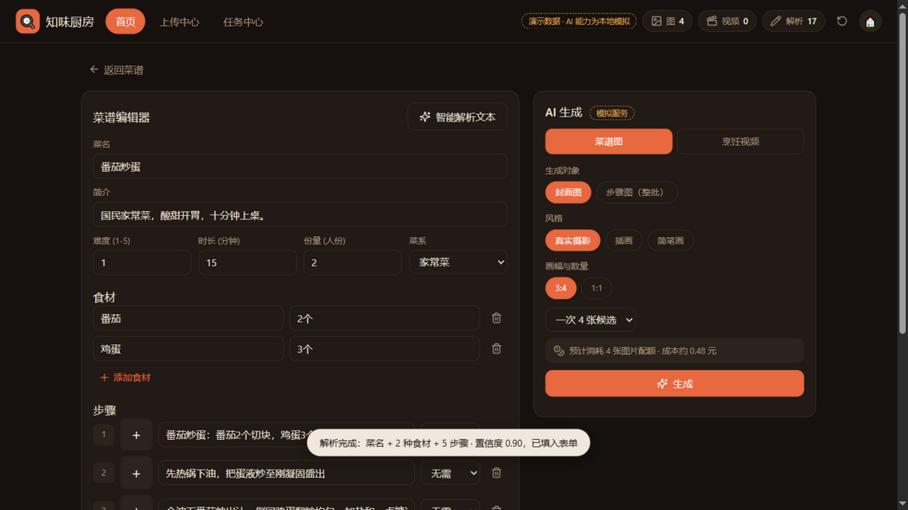 |
| T5 | AI 生图：4 候选生成、配额预扣 10→6、采用封面生效、单张重绘扣 1 且必换图案 | ✅（修复后） | 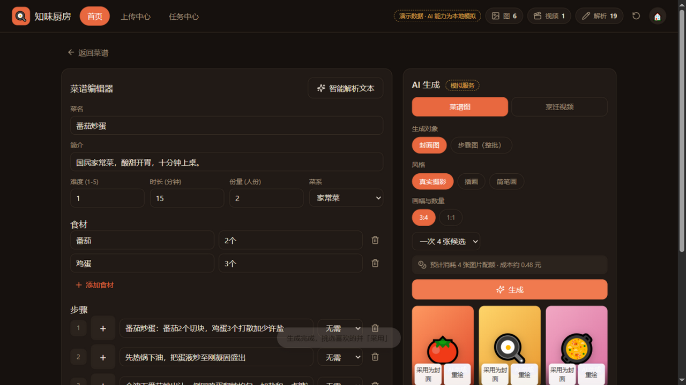 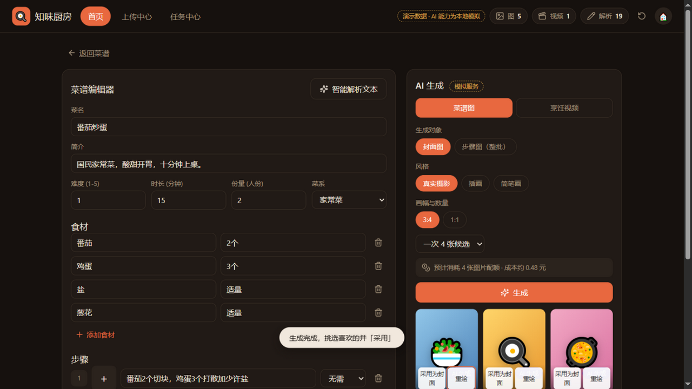 |
| T6 | AI 生视频：分镜脚本 4 镜 32s（30–60s 校验）→ 提交 → 排队/生成/拼接状态机 → 成功 → 详情页播放器推进（0:10/0:32、字幕切步、进度 30%）、AI 水印 | ✅ | 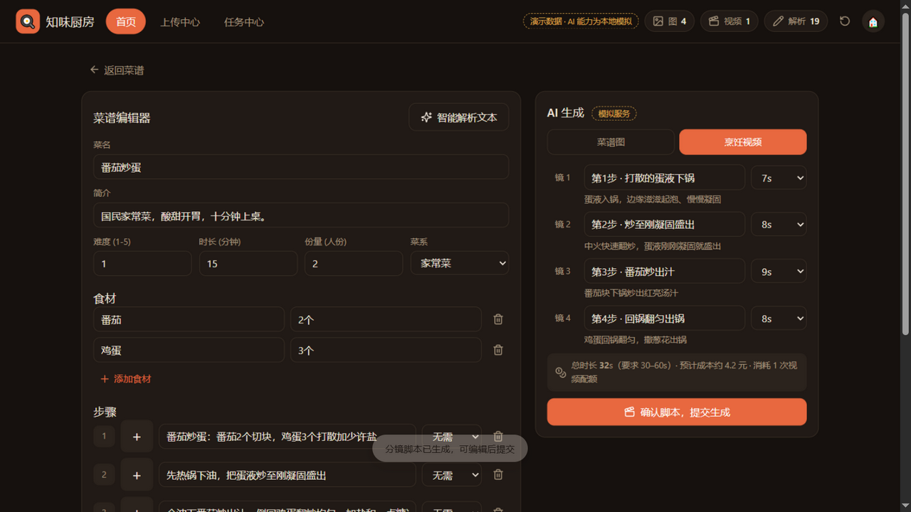 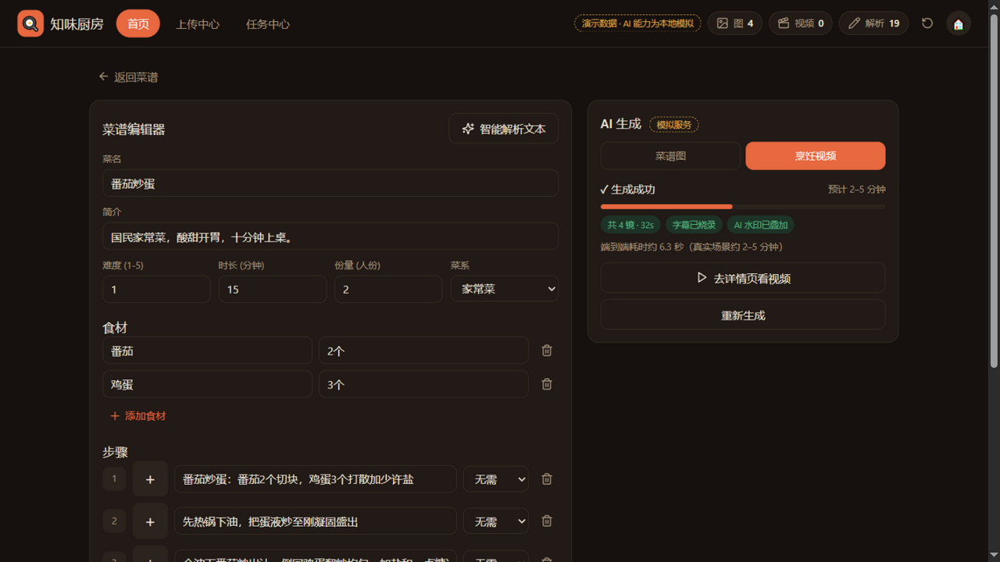 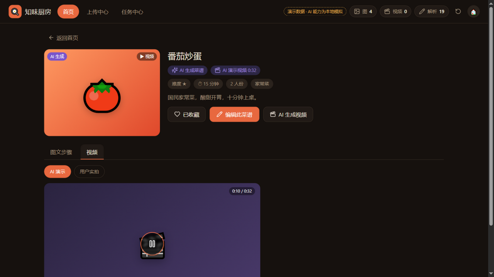 |
| T7 | 上传：未勾选版权拦截 toast → 勾选后分片上传（进度 58%→100%）→ 转码 + 机审 → 就绪卡 → 挂载到《戚风蛋糕》 | ✅ | 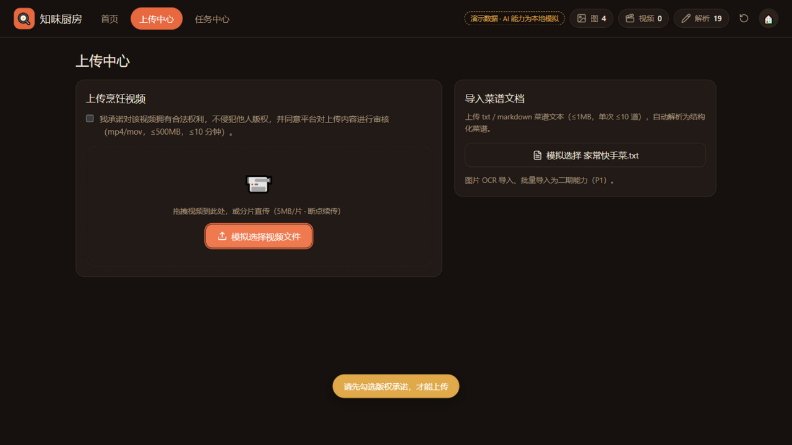 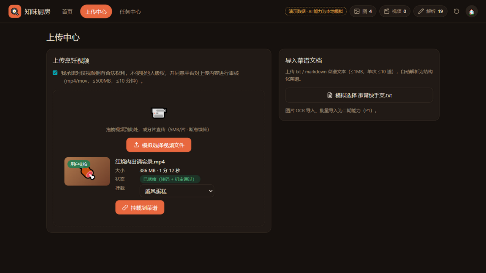 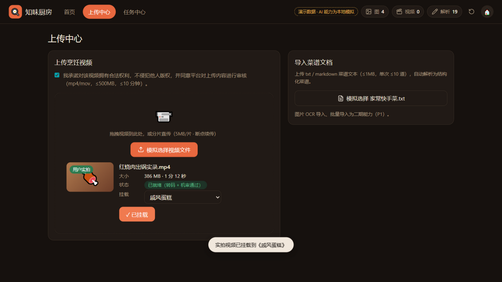 |
| T8 | 任务中心：11 条记录（解析/生图/分镜/生视频/上传），类型、状态、成本、耗时全部正确 | ✅ | 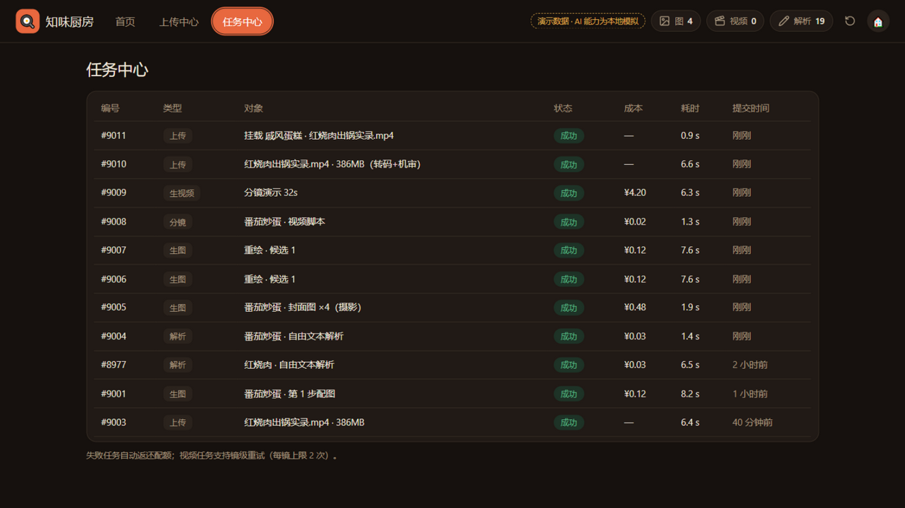 |
| T9 | 移动端 375×700：底部导航、单列卡片、表格换行无溢出、chip 换行 | ✅ | 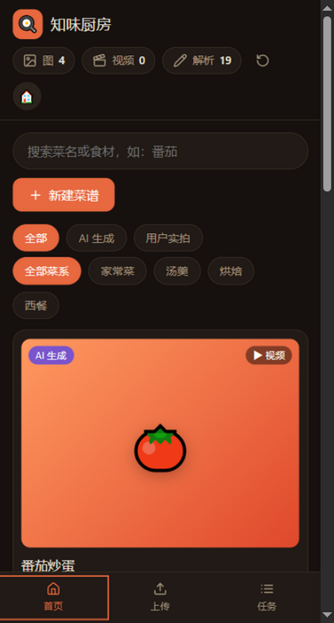 |
| T12 | 线上验收：GitHub Pages 真实加载（渲染完整、manifest 可达、Service Worker active 可安装） | ✅ | 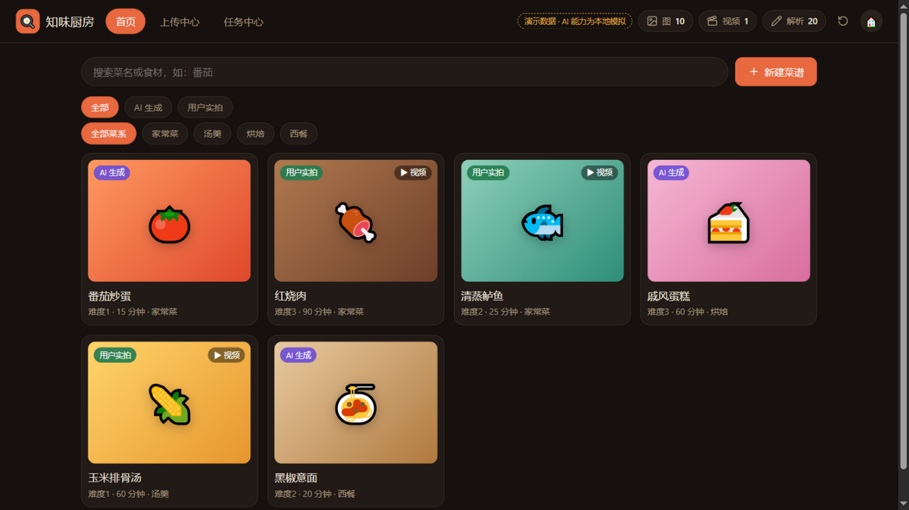 |

## 二、发现的问题与修复记录

| # | 等级 | 问题 | 根因 | 修复 | 回归 |
| --- | --- | --- | --- | --- | --- |
| 1 | P2 | 模拟解析质量弱：菜名前缀混入步骤文本、"全程约15分钟，2人份"等元信息被当作步骤、调料类食材漏抓 | `services.js` 启发式过于简单 | 步骤句过滤元信息正则 + 去标题前缀；单位表扩充；从"加/放/撒/淋 X"补充调料 | ✅ T10 |
| 2 | P3 | 重绘可能抽中与当前相同的图案/配色，观感像未生效 | 随机池未排除当前值 | 重绘配色与图案均从"排除当前值"的池中随机 | ✅ T11 |
| 3 | P2（发布策略） | 更新 JS 后客户端仍命中 Service Worker 旧缓存 | cache-first 但缓存版本号固定 | 明确发布约定：**每次发版必须递增 `sw.js` 的 CACHE 版本号**（已写入 sw.js 注释与 README） | ✅ T10（v2 生效） |

## 三、环境准备记录（与正式测试区分）

- 启动本地静态服务器（`python -m http.server 8080`）。
- 修复回归前执行过一次测试环境重置：卸载 Service Worker、清空 CacheStorage 与 localStorage（仅用于使新代码生效，不用于替代任何被测行为）。
- 测试过程未注入任何 JavaScript 修改页面状态；所有交互通过真实点击/键盘完成。

## 四、测试工具限制说明（如实记录）

- 空字符串 `fill("")` 在该浏览器内核下为无效操作——已改用真实用户路径（点击 + 全选 + 退格）验证清空行为。
- 对部分 `<button>` 元素，Playwright 定位点击出现超时（命中测试确认无遮挡、元素可点），按规范改用**坐标路径点击**（CUA）完成测试；被测行为与真实点击一致。
- 运行时不提供 console 日志采集能力；以页面可见错误表现（空白、报错文案、布局崩坏）为准——全程未观察到此类表现。
- 原型验证阶段的两次"重绘无效"疑点经任务账本核实为**测试脚本坐标点错候选**，应用无缺陷（详见测试过程记录）。

## 五、遗留事项

- 图片/视频生成与上传/转码/机审为**前端模拟服务**（界面与流程已验收）；接入真实 API 时仅需替换 `js/services.js` 中的 `*Pipeline` 函数。
- 二期能力（图片 OCR 导入、批量生成、内容审核后台）未在本次范围。
